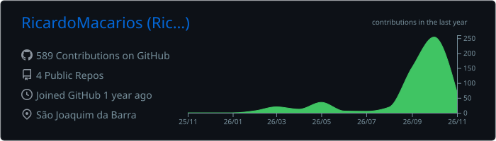
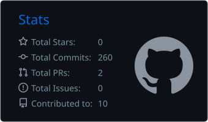
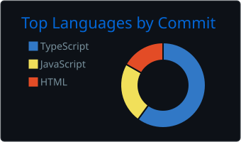

# Ricardo Parise Macarios Junior

---

## 👨‍💻 Sobre mim

Sou de São Joaquim da Barra – SP e estudo **Sistemas de Informação na FAFRAM**. Venho da área técnica de química e hoje direciono minha carreira para o **desenvolvimento back-end**: APIs, bancos de dados, regras de negócio e sistemas que resolvem problemas reais.

- 🚀 Fundador da **BarberVez**, SaaS de agendamento para barbearias com clientes ativos
- 🛠️ Desenvolvo sistemas de gestão (estoque, agendamento, cadastro) do banco de dados à interface
- 📚 Atualmente aprofundando em **Node.js, SQL e arquitetura de APIs**
- 🎯 Buscando oportunidade como **desenvolvedor júnior / estágio**

---

## 💼 Projetos em destaque

| Projeto | O que faz | Stack |
|---|---|---|
| **BarberVez** | SaaS de agendamento para barbearias, com login por barbeiro e painel de gestão | React · Node.js · Supabase |
| **Renova** | SaaS multi-tenant de agendamento e gestão para salões de beleza | React · Node.js · Supabase |
| [**RedeEsperança**](https://github.com/RicardoMacarios/RedeEsperanca) | Cadastro e gestão de ONGs e voluntários, com autenticação JWT e upload de arquivos | React · Node.js · Supabase · JWT · Multer |
| [**Controle de Estoque Químico**](https://github.com/RicardoMacarios/Controle-de-estoque-qu-mico) | Gerenciamento de estoque de reagentes com entradas, saídas e consulta | JavaScript · HTML · CSS |
| [**Valve Management System**](https://github.com/RicardoMacarios/valve-management-system) | Cadastro e acompanhamento de válvulas e manutenções | JavaScript · HTML · CSS |

---

## 🛠️ Tecnologias

**Back-end & Dados**

**Front-end & Ferramentas**

---

## 📊 Estatísticas

---

<picture>
  <source media="(prefers-color-scheme: dark)" srcset="https://raw.githubusercontent.com/RicardoMacarios/RicardoMacarios/output/github-snake-dark.svg" />
  
</picture>

